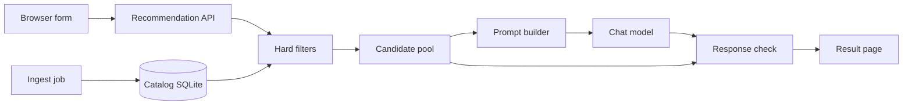

# Zomato — Restaurant Recommendation Architecture

This document is the architecture for the product in [problemStatement.md](problemStatement.md). It turns that workflow into components, data, and request behavior.

The service recommends restaurants from the Hugging Face dataset `ManikaSaini/zomato-restaurant-recommendation`. A person states location, budget band, cuisine, minimum rating, and an optional extra preference. Hard filters run first. A language model then ranks a capped candidate list and writes a reason for each pick. The screen shows at most five restaurants, each with name, cuisine, rating, approximate cost for two, and that reason.

The dataset is a static Bangalore dump of 51,717 listing rows. This system does not call live Zomato, does not train a model, and does not take orders.

## Principles

1. **Filters before the model.** A restaurant that misses location, budget, cuisine, or minimum rating never reaches the model and never appears on the screen.
2. **One card per restaurant.** Listing rows collapse before any request is served.
3. **Reasons stay checkable.** A number in an explanation has to appear on that restaurant’s candidate record. A restaurant id the model invents is dropped.
4. **The model is optional at runtime.** A missing key, a timeout, or an invalid response still returns the filtered restaurants, ordered by rating and votes, with a sentence built from the row.
5. **The catalog is built once.** Requests read a local table. They do not download the 574 MB dataset and they do not send raw `reviews_list` to the model.

## System



| Piece | Responsibility |
| --- | --- |
| Ingest job | Load the dataset, parse fields, collapse duplicate listings, compute budget cutoffs, write the catalog and a manifest. |
| Catalog | One row per restaurant, plus the manifest. Read-only while the server is up. |
| Recommendation API | Validate the form, run filters, call the ranker, return the page model. |
| Hard filters | Location, budget band, cuisine, minimum rating. |
| Candidate pool | At most 20 restaurants from the filtered set, chosen by a fixed sort. |
| Prompt builder | Preferences plus compact candidate records. |
| Chat model | OpenAI-compatible chat completions. Returns JSON ranks and explanations. |
| Response check | Drops unknown ids and replaces an explanation whose numbers are not on the record. |
| Result page | Form, up to five cards, and an empty state when nothing matches. |

Process layout: one Python process. FastAPI serves HTML and `POST /recommendations`. SQLite is the catalog. `httpx` calls the model. The Hugging Face `datasets` library is an ingest dependency, not a request dependency.

Suggested layout when the app is built:

```text
app/
  ingest.py        load, parse, collapse, write catalog
  catalog.py       open SQLite, read restaurants and manifest
  filters.py       location, budget, cuisine, rating
  prompt.py        candidate JSON and the instructions
  ranker.py        chat client, response check, fallback
  main.py          routes and page rendering
  templates/       form and result markup
data/
  catalog.sqlite   generated, not committed
docs/
  problemStatement.md
  architecture.md
```

## Ingest

Ingest is a separate command. It replaces `data/catalog.sqlite`. The server refuses to start when the file or the manifest is missing.

Steps:

1. Load the `train` split of `ManikaSaini/zomato-restaurant-recommendation`.
2. Parse each listing row into the fields below. Keep a counter of rows dropped or left partially empty.
3. Collapse rows that are the same restaurant.
4. Compute budget cutoffs from the parsed costs.
5. Write `restaurants` and `manifest` in one transaction.
6. Print the manifest, including every distinct `rate` string that did not parse.

### Parsed listing

| Field | Source | Rule |
| --- | --- | --- |
| `name` | `name` | Trimmed. A blank name drops the row. |
| `address` | `address` | Trimmed. A blank address drops the row. |
| `location` | `location` | Trimmed neighborhood. Blank becomes empty and fails a neighborhood filter. |
| `listed_cities` | `listed_in(city)` | One value on the raw row. |
| `cuisines` | `cuisines` | Split on commas, trim, drop empties. |
| `cost_for_two` | `approx_cost(for two people)` | Strip commas and spaces, parse an integer. Anything else is null. |
| `rating` | `rate` | First number in the string if it is between 0 and 5 inclusive. Otherwise null. |
| `votes` | `votes` | Integer. Missing becomes 0. |
| `rest_types` | `rest_type` | Split on commas, trim, drop empties. |
| `dishes_liked` | `dish_liked` | Split on commas, trim, drop empties. |
| `online_order` | `online_order` | True only when the value is `Yes`, ignoring case. |
| `book_table` | `book_table` | True only when the value is `Yes`, ignoring case. |
| `url` | `url` | Stored for the card link. Omitted from the model prompt. |
| `review_excerpt` | `reviews_list` | See below. |
| `phone`, `menu_item` | those columns | Not stored. The screen does not use them. |

`rate` has 64 distinct strings in the dataset viewer. Ingest does not hard-code that list. A string that yields no number in range is a missing rating, and the distinct rejected strings are stored on the manifest so the parser can be checked against the real file.

### Review excerpt

`reviews_list` can be about 1.28 million characters. Ingest keeps a single excerpt of at most 400 characters:

- Parse the value as a Python literal of a list of `(rating, text)` pairs when that parse succeeds.
- Take the text of the first pair.
- Collapse whitespace and cut at 400 characters.
- On any parse failure, store an empty excerpt. The restaurant stays in the catalog.

The raw review column is not written to SQLite and is not sent to the model.

### One restaurant from many rows

The same place can appear once per `listed_in(type)` and `listed_in(city)`. The collapse key is `normalize(name) + "\n" + normalize(address)`, where `normalize` casefolds and collapses internal whitespace.

The surviving row is the listing with the highest `votes`. Ties break toward the higher parsed `rating`, then toward a non-null `cost_for_two`. From the other listings, merge:

| Field | Merge |
| --- | --- |
| `cuisines`, `rest_types`, `dishes_liked`, `listed_cities` | Union, order preserved from the winning row first |
| `online_order`, `book_table` | True if any listing is true |
| `review_excerpt` | The excerpt from the winning row |
| `url`, `location`, `rating`, `votes`, `cost_for_two` | Taken from the winning row only |

The restaurant id is a stable SHA-256 of the collapse key, hex, first 16 characters. Cards and the model both use this id.

### Budget cutoffs

Cost in the file is an approximate cost for two people. Bands are tertiles of `cost_for_two` over restaurants where that value is non-null, computed once at ingest:

| Band | Cost for two |
| --- | --- |
| `low` | Less than or equal to the 33rd percentile |
| `medium` | Greater than the 33rd percentile and less than or equal to the 66th percentile |
| `high` | Greater than the 66th percentile |

Percentiles use the nearest-rank method on the sorted costs. The three edges are integers and are stored on the manifest. The form shows them, for example “Medium is ₹500–₹800 for two”, using the stored edges. A restaurant with a null cost matches no band.

### Manifest

The manifest is one row the API reads on startup:

| Field | Meaning |
| --- | --- |
| `dataset` | `ManikaSaini/zomato-restaurant-recommendation` |
| `built_at` | UTC timestamp of the ingest |
| `source_rows` | Rows read from the split |
| `restaurant_count` | Rows in `restaurants` |
| `dropped_blank_identity` | Rows dropped for a blank name or address |
| `missing_rating` | Restaurants with a null rating |
| `missing_cost` | Restaurants with a null cost |
| `unparsed_rate_values` | Distinct `rate` strings that did not yield a rating |
| `cost_p33`, `cost_p66` | Budget edges in rupees |

## Catalog record

SQLite table `restaurants`, one row per restaurant:

| Column | Type | Used for |
| --- | --- | --- |
| `id` | text primary key | Identity in the prompt and the response check |
| `name` | text | Card and prompt |
| `address` | text | Card secondary line |
| `location` | text | Location filter and card |
| `listed_cities` | text, JSON array | Location filter |
| `cuisines` | text, JSON array | Cuisine filter, card, prompt |
| `cost_for_two` | integer, nullable | Budget filter and card |
| `rating` | real, nullable | Rating filter, sort, card |
| `votes` | integer | Sort and explanation evidence |
| `rest_types` | text, JSON array | Prompt evidence |
| `dishes_liked` | text, JSON array | Prompt evidence |
| `online_order` | integer 0/1 | Card and prompt evidence |
| `book_table` | integer 0/1 | Card and prompt evidence |
| `url` | text | Card link only |
| `review_excerpt` | text | Prompt evidence |

Indexes: `location`, `rating`, `cost_for_two`. Cuisine matching is done in process after the SQL prefilter, because cuisines are a list.

## Request path

`POST /recommendations` accepts form fields:

| Field | Required | Rule |
| --- | --- | --- |
| `location` | yes | Non-blank string, at most 80 characters |
| `budget` | yes | `low`, `medium`, or `high` |
| `cuisine` | yes | Non-blank string, at most 40 characters |
| `min_rating` | yes | Number from 0 to 5 inclusive |
| `extra` | no | Free text, at most 200 characters. Blank means no extra preference. |

A field that fails validation redisplays the form with the error. The catalog and the model are not touched.

When the form is valid:

1. Resolve location.
2. Apply budget, cuisine, and rating filters.
3. If the filtered set is empty, render the empty state. The model is not called.
4. Sort the filtered set by `rating` descending, `votes` descending, `name` ascending. Null ratings cannot be in the set once a minimum rating is set.
5. Keep the first 20. This is the candidate pool.
6. Ask the ranker to order that pool and explain the picks.
7. Render at most five cards.

`GET /` renders the form. It loads the manifest so the budget labels show the stored rupee edges, and it loads the distinct `location` values for the location field’s suggestions. `GET /health` returns 200 when the catalog file opens and the manifest has `restaurant_count` greater than zero.

## Filters

All four structured preferences are hard filters. The extra preference is not a filter.

### Location

Compare a casefolded, trimmed query.

| Query | Result |
| --- | --- |
| `bangalore`, `bengaluru` | Every restaurant. The dataset is Bangalore listings, and those names are not neighborhoods in the `location` column. |
| Exact `location` | Restaurants with that neighborhood. |
| Else exact membership in `listed_cities` | Restaurants listed in that area. |
| Anything else | Empty filtered set. |

`address` is not a filter. A street-word query would keep unrelated restaurants.

### Budget

Compare `cost_for_two` to `cost_p33` and `cost_p66` from the manifest, using the band table above. Null costs drop out.

### Cuisine

Case-insensitive substring against the joined cuisine list. “Chinese” matches “North Indian, Chinese”. A restaurant with an empty cuisine list drops out.

### Minimum rating

Keep restaurants whose `rating` is greater than or equal to `min_rating`. Null ratings drop out.

### Extra preference

Passed through to the prompt as text the model may use. It does not add or remove candidates. Evidence the model may cite for it is `rest_types`, `dishes_liked`, and `review_excerpt`. When those fields do not support the preference, the explanation says the listing does not show it.

`online_order` and `book_table` are evidence on the card and in the prompt. They are not filters and they are not form fields.

## Candidate pool and what the model may do

The pool cap is 20. The screen shows 5. Both limits shrink when fewer restaurants remain.

The model receives the 20 records and returns an ordered list of their ids. It may rank any subset. The server then:

- Drops ids that are not in the pool.
- Drops duplicate ids, keeping the first.
- Fills any shortfall, up to five, from the pool’s original sort, skipping ids already used.
- Shows the first five of that merged list.

A card’s name, cuisines, rating, votes, cost, location, online-order flag, and table-booking flag are copied from the catalog. They are never copied from the model’s prose.

### Candidate record in the prompt

```json
{
  "id": "ab12cd34ef567890",
  "name": "Jalsa",
  "location": "Banashankari",
  "cuisines": ["North Indian", "Mughlai", "Chinese"],
  "costForTwo": 800,
  "rating": 4.1,
  "votes": 775,
  "restTypes": ["Casual Dining"],
  "dishesLiked": ["Pasta", "Dum Biryani"],
  "onlineOrder": true,
  "bookTable": true,
  "reviewExcerpt": "A beautiful place to dine in."
}
```

`url` and `address` stay off this payload. Empty lists and an empty excerpt are sent as empty values so the model can see that the listing lacks them.

## Model contract

The ranker is a chat-completions client aimed at an OpenAI-compatible HTTP API. This project calls Groq: `LLM_BASE_URL` is `https://api.groq.com/openai/v1` and `LLM_MODEL` is a Groq model id (`openai/gpt-oss-120b` is the production model the service is set up for). The same process can still call another compatible host by changing those variables. The API key stays in the environment.

| Variable | Role |
| --- | --- |
| `LLM_BASE_URL` | API origin, including the `/v1` prefix the host expects |
| `LLM_API_KEY` | Bearer token |
| `LLM_MODEL` | Model id |
| `LLM_TIMEOUT_SECONDS` | Default 20 |

When any of the first three is unset, the ranker does not make a call. It uses the fallback described below.

One request, `temperature` 0, response constrained to JSON. The user message contains the preferences and the candidate array. The instructions are:

- Rank only ids from the candidate array.
- Return JSON of the shape below and nothing else.
- Write each explanation in one or two sentences.
- Use a cost, rating, or vote count only when that exact number is on the candidate.
- Mention the extra preference only when `restTypes`, `dishesLiked`, or `reviewExcerpt` supports it. Otherwise say the listing does not show that preference.
- Leave `summary` as a single sentence about the set, or an empty string.

```json
{
  "summary": "Two casual dining places in Banashankari fit the budget and rating.",
  "ranked": [
    {"id": "ab12cd34ef567890", "explanation": "Rated 4.1 from 775 votes, about 800 for two, and the cuisines include Chinese."}
  ]
}
```

The server parses this with a schema. On a timeout, an HTTP error, or a body that is not that schema, it tries the call once more. A second failure uses the fallback. The fallback also runs when the environment is unset.

### Fallback

`source` is `fallback`. Order is the pool’s original sort. Each explanation is the fixed sentence:

> {name} in {location} serves {cuisines}, rated {rating} from {votes} votes, about ₹{cost} for two.

`summary` is empty. The page says the list is ordered by rating and votes because a model ranking was not available. No sentence is written that pretends the model ran.

### Explanation check

For a model explanation, collect the numbers in the sentence. Each number must equal that candidate’s `rating`, `votes`, or `costForTwo`, comparing ratings to one decimal place and the others as integers. A sentence that fails the check is replaced with the fallback sentence for that restaurant. The card’s other fields still come from the catalog. The page `source` stays `model` when the call itself succeeded, and the card records `explanationFrom` as `model` or `template`.

## Result page

The page shows the form again with the submitted values, then the outcome.

A card shows, in this order:

- Name, linked with `url` when the url is non-empty
- Cuisines, joined from the catalog list
- Rating and vote count
- Approximate cost for two, in rupees
- Neighborhood
- Online order and table booking, as yes or no
- The explanation

Above the cards, when `source` is `model` and the summary is non-empty, show the summary. When `source` is `fallback`, show the fallback notice.

The empty state names the filters that were applied and shows the location and cuisine the person entered. It offers the form again. It does not suggest restaurants from outside the filtered set.

Cost on the card is always labeled for two people.

## Failure behavior

| Situation | Behavior |
| --- | --- |
| Catalog file missing on startup | Process exits. Ingest has not been run. |
| Invalid form field | Form redisplays with the error. No catalog scan and no model call. |
| Location matches nothing | Empty state. No model call. |
| Filters remove every restaurant | Empty state. No model call. |
| Filtered set is smaller than 20 or 5 | Pool and page use the shorter length. |
| Model environment unset | Fallback list. |
| Model timeout or HTTP error | One retry, then fallback. |
| Model JSON fails the schema | One retry, then fallback. |
| Model returns an unknown id | That id is dropped. |
| Explanation cites a number that is not on the record | That explanation is replaced with the template. |
| `reviews_list` does not parse | Empty excerpt. Restaurant remains eligible. |
| Null rating or null cost | Restaurant fails the rating filter or the budget filter. |
| Blank name or address at ingest | Row is dropped and counted on the manifest. |

## Decisions that close the open questions

These are the architecture choices for the eight questions in the problem statement.

| Question | Decision |
| --- | --- |
| How many recommendations? | Five cards. Fewer when the filtered set is smaller. The model sees at most 20 candidates. |
| What is low, medium, and high? | Tertiles of parsed cost-for-two, computed at ingest and stored as `cost_p33` and `cost_p66`. The form prints those rupee edges. |
| Which location column? | `bangalore` and `bengaluru` keep the whole catalog. Any other query must match `location` exactly, or else a value in `listed_cities`. Address is not a filter. |
| How do duplicate rows collapse? | Key is normalized name plus address. The highest-vote listing wins the scalar fields. Cuisines, restaurant types, liked dishes, and listing cities are unions. |
| Which rating strings count? | A number from 0 to 5 in the string counts. Every other distinct `rate` value is logged on the manifest at ingest. |
| Which model, and what if it fails? | Groq at `https://api.groq.com/openai/v1`, model id from `LLM_MODEL` (`openai/gpt-oss-120b` for this project). Failure, or a missing configuration, returns the filtered pool ordered by rating and votes with template sentences. |
| Where can an extra preference come from? | It is soft. The model may cite `rest_types`, `dishes_liked`, and the 400-character review excerpt. It does not change membership. |
| What are online order and book table? | Evidence on the card and in the prompt. They are not filters. |

## Tests the architecture requires

- A rating string with a number in range parses; `NEW`, `-`, and blank become null.
- A cost of `1,200` parses to 1200; a blank cost is null.
- Two listings with the same normalized name and address become one restaurant, scalar fields from the higher-vote row, cuisines unioned.
- `bangalore` does not filter by neighborhood. A known neighborhood keeps only that `location`. An unknown location yields an empty set and does not call the model.
- Cuisine match is a case-insensitive substring. An empty cuisine list does not match.
- A null cost matches no budget band. Bands follow the manifest edges.
- A model response that names an id outside the pool does not create a card for it.
- An explanation that mentions a cost other than `costForTwo` is replaced by the template.
- With the model environment unset, the response `source` is `fallback` and the order is rating, then votes, then name.
- An empty filtered set does not open an HTTP connection to the model.
